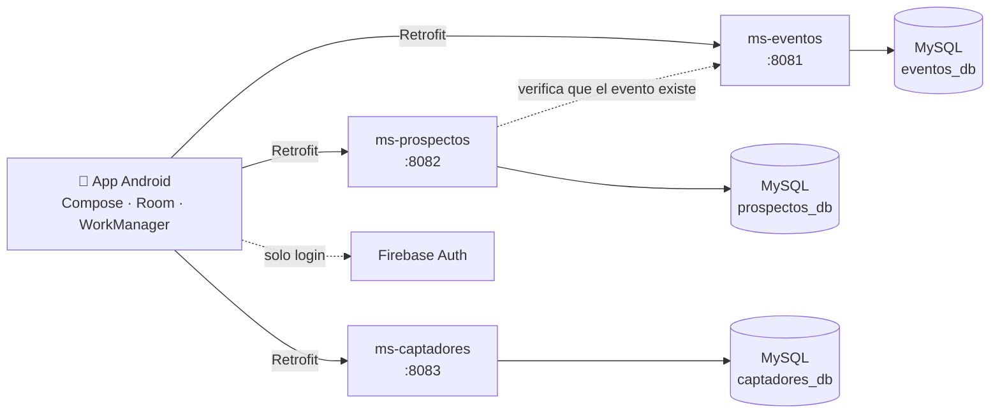

<h1 align="center">📲 Captura Digital Móvil de Prospectos</h1>

<p align="center">
  App Android para captar prospectos en terreno, <b>incluso sin internet</b>, y sincronizarlos con <b>microservicios Spring Boot</b>.
</p>

<p align="center">
  
  
  
  
  
  
</p>

> 📚 Proyecto académico de la asignatura **DSY1105 – Desarrollo de Aplicaciones Móviles** (Duoc UC, Analista Programador). Equipo **TherionLabs**.

---

## 📋 Tabla de contenidos

- [Equipo](#-equipo)
- [Qué hace la app](#-qué-hace-la-app)
- [Arquitectura](#-arquitectura)
- [Estructura del repositorio](#-estructura-del-repositorio)
- [Microservicios](#-microservicios)
- [Cómo ejecutar](#-cómo-ejecutar)
- [Flujo de trabajo con Git](#-flujo-de-trabajo-con-git)

---

## 👥 Equipo

| Integrante | Responsabilidad principal |
|---|---|
| Kevin Gonzalez | `ms-prospectos` |
| José Sánchez | `ms-eventos` |
| Diego Jiménez | `ms-captadores` · app móvil |

---

## ✨ Qué hace la app

- **Inicio de sesión** de captadores con Firebase Authentication.
- **Selección de evento** escaneando un código QR (CameraX + ML Kit) o ingresando el código a mano.
- **Registro de prospectos** (alumnos) con validación de RUT, correo y celular.
- **Funciona sin red:** todo se guarda primero en el teléfono (Room) y se sincroniza solo cuando vuelve la conexión (WorkManager).
- **Historial y lista de prospectos** capturados por evento.

---

## 🧩 Arquitectura

La app nunca habla con la base de datos: solo con los microservicios, y cada microservicio tiene su propio esquema MySQL.



---

## 🗂️ Estructura del repositorio

```
TherianLabs/
├── app-movil/            # Proyecto Android completo (Kotlin + Compose)
│   ├── app/
│   ├── gradle/
│   ├── build.gradle.kts
│   └── settings.gradle.kts
├── backend/              # Microservicios Spring Boot
│   ├── ms-eventos/       # Eventos y códigos QR
│   ├── ms-prospectos/    # Prospectos (CRUD)
│   └── ms-captadores/    # Captadores
└── README.md
```

Las dos carpetas son independientes: `app-movil/` se abre con Android Studio y cada microservicio de `backend/` se abre por separado en el IDE de Java.

---

## 🛠️ Microservicios

| Servicio | Puerto | Responsable | Qué hace | Tests |
|---|---|---|---|---|
| [`ms-eventos`](backend/ms-eventos) | 8081 | José | Eventos (CRUD, abrir y cerrar). Escritura protegida con JWT (rol `ADMIN`) | 35 |
| [`ms-prospectos`](backend/ms-prospectos) | 8082 | Kevin | Prospectos: CRUD, validación de RUT, carga por lote (hasta 500) y validación del evento contra ms-eventos | 52 |
| [`ms-captadores`](backend/ms-captadores) | 8083 | Diego | Registro y login de captadores con JWT | 68 |

Cada uno es un proyecto Maven propio con arquitectura en capas (`controller`, `service`, `repository`, `model`, más `dto`, `mapper` y `exception`), su propia base MySQL y su README con las rutas.

---

## ▶️ Cómo ejecutar

Requisitos: **Java 17 o superior**, **Maven**, **MySQL** encendido y **Android Studio**.

### 1. Microservicios

Cada servicio en su propia terminal. Las bases se crean solas. Si tu MySQL tiene otra clave, pásala con `DB_PASSWORD`.

```bash
# ms-eventos (8081): necesita backend/ms-eventos/secrets.properties con la clave JWT
cd backend/ms-eventos
echo "app.jwt.secret=<clave base64 de 32 bytes o más>" > secrets.properties
./mvnw spring-boot:run

# ms-prospectos (8082)
cd backend/ms-prospectos
mvn spring-boot:run

# ms-captadores (8083)
cd backend/ms-captadores
./mvnw spring-boot:run
```

En Windows con MySQL sin clave (`root` vacío), agrega al final de cada comando:
`"-Dspring-boot.run.arguments=--spring.datasource.password="`

### 2. App Android

1. Abrir la carpeta **`app-movil/`** con Android Studio y sincronizar Gradle.
2. Ejecutar en un emulador (minSdk 24). Desde el emulador los servicios se alcanzan en `http://10.0.2.2:<puerto>/`.
3. Iniciar sesión (Firebase Auth), sincronizar eventos y escanear o escribir un código como `EVT-0042`.

La app guarda todo primero en el teléfono (Room) y envía los prospectos por lotes a ms-prospectos cuando hay red (WorkManager). Si el evento fue cerrado, el servidor rechaza el registro y la app lo marca como *Rechazado*.

---

## 🧪 Pruebas y cobertura

| Módulo | Comando | Cobertura (JaCoCo) |
|---|---|---|
| ms-prospectos | `mvn test` | 99 % |
| ms-eventos | `./mvnw test` | reporte en `target/site/jacoco/index.html` |
| ms-captadores | `./mvnw test` | reporte en `target/site/jacoco/index.html` |
| App Android | `./gradlew testDebugUnitTest jacocoTestReport` (en `app-movil/`) | 95 % instrucciones · 98 % líneas |

Los tests de los servicios usan H2 en memoria, así que no necesitan MySQL. En la app la cobertura se mide sobre las clases de lógica (`util`, `model` y `LoteMapper`); las pantallas Compose, los ViewModels y Room no se incluyen porque requieren emulador. El reporte de la app queda en `app-movil/app/build/reports/jacoco/jacocoTestReport/html/index.html`.

---

## 📦 APK firmado

El APK release firmado se genera desde Android Studio: *Build → Generate Signed App Bundle / APK → APK → release*. El keystore no está en el repositorio. El archivo resultante queda en `app-movil/app/release/app-release.apk`.

---

## 🔀 Flujo de trabajo con Git

- La rama `master` es la versión estable: no se trabaja directo en ella.
- Cada cambio va en una rama (`feat/...`, `fix/...`) y entra por Pull Request.
- Mensajes de commit claros y en presente: `feat: agrega CRUD de prospectos`.
- Los cambios de `backend/` y de `app-movil/` se commitean por separado para no mezclar la app con los servicios.
