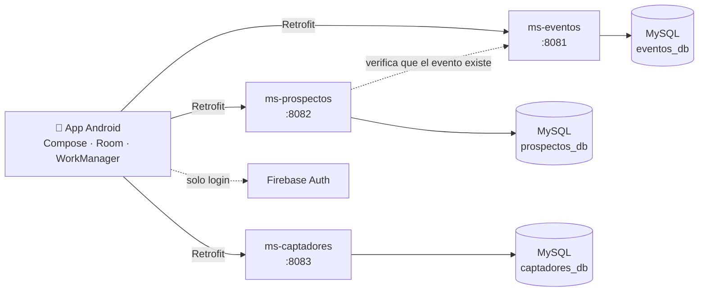

<h1 align="center">📲 Captura Digital Móvil de Prospectos</h1>

<p align="center">
  App Android para captar prospectos en terreno, <b>incluso sin internet</b>, y sincronizarlos con <b>microservicios Spring Boot</b>.
</p>

<p align="center">
  
  
  
  
  
  
</p>

> 📚 Proyecto académico de la asignatura **DSY1105 – Desarrollo de Aplicaciones Móviles** (Duoc UC, Analista Programador). Equipo **TherionLabs**.

---

## 📋 Tabla de contenidos

- [Equipo](#-equipo)
- [Qué hace la app](#-qué-hace-la-app)
- [Arquitectura](#-arquitectura)
- [Estructura del repositorio](#-estructura-del-repositorio)
- [Microservicios](#-microservicios)
- [Cómo ejecutar](#-cómo-ejecutar)
- [Flujo de trabajo con Git](#-flujo-de-trabajo-con-git)

---

## 👥 Equipo

| Integrante | Responsabilidad principal |
|---|---|
| Kevin Gonzalez | `ms-prospectos` |
| José Sánchez | `ms-eventos` |
| Diego Jiménez | `ms-captadores` · app móvil |

---

## ✨ Qué hace la app

- **Inicio de sesión** de captadores con Firebase Authentication.
- **Selección de evento** escaneando un código QR (CameraX + ML Kit) o ingresando el código a mano.
- **Registro de prospectos** (alumnos) con validación de RUT, correo y celular.
- **Funciona sin red:** todo se guarda primero en el teléfono (Room) y se sincroniza solo cuando vuelve la conexión (WorkManager).
- **Historial y lista de prospectos** capturados por evento.

---

## 🧩 Arquitectura

La app nunca habla con la base de datos: solo con los microservicios, y cada microservicio tiene su propio esquema MySQL.



---

## 🗂️ Estructura del repositorio

```
TherianLabs/
├── app-movil/            # Proyecto Android completo (Kotlin + Compose)
│   ├── app/
│   ├── gradle/
│   ├── build.gradle.kts
│   └── settings.gradle.kts
├── backend/              # Microservicios Spring Boot
│   ├── ms-eventos/       # Eventos y códigos QR
│   ├── ms-prospectos/    # Prospectos (CRUD)
│   └── ms-captadores/    # Captadores
└── README.md
```

Las dos carpetas son independientes: `app-movil/` se abre con Android Studio y cada microservicio de `backend/` se abre por separado en el IDE de Java.

---

## 🛠️ Microservicios

| Servicio | Puerto | Responsable | Estado |
|---|---|---|---|
| [`ms-eventos`](backend/ms-eventos) | 8081 | José | En desarrollo |
| [`ms-prospectos`](backend/ms-prospectos) | 8082 | Kevin | CRUD base listo |
| [`ms-captadores`](backend/ms-captadores) | 8083 | Diego | En desarrollo |

Cada uno es un proyecto Maven propio (Java 17, Spring Boot 3.4) con arquitectura en capas: `controller`, `service`, `repository` y `model`.

---

## ▶️ Cómo ejecutar

### App Android
1. Abrir la carpeta **`app-movil/`** con **Android Studio**.
2. Sincronizar Gradle y ejecutar en un emulador o dispositivo (minSdk 24).
3. En el emulador, los microservicios locales se alcanzan en `http://10.0.2.2:<puerto>/`.

### Microservicios
Requisitos: **Java 17**, **Maven** y **MySQL** encendido.

```bash
cd backend/ms-prospectos
mvn spring-boot:run
```

Usuario y clave de MySQL por defecto: `root` / `root` (se cambian con las variables `DB_USER` y `DB_PASSWORD`).

---

## 🔀 Flujo de trabajo con Git

- La rama `master` es la versión estable: no se trabaja directo en ella.
- Cada cambio va en una rama (`feat/...`, `fix/...`) y entra por Pull Request.
- Mensajes de commit claros y en presente: `feat: agrega CRUD de prospectos`.
- Los cambios de `backend/` y de `app-movil/` se commitean por separado para no mezclar la app con los servicios.
